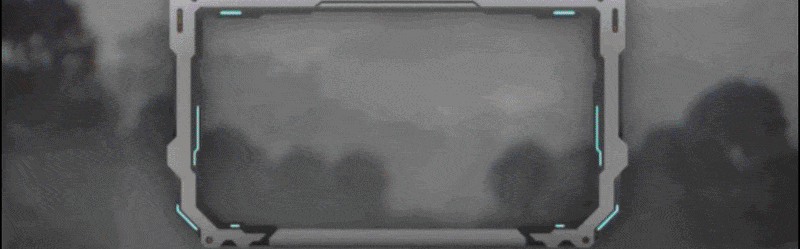

# Singular.Live Rive Widget  

**Integrating Rive animations into the Singular Live platform for next-gen real-time graphics.**  

This project brings **Rive’s WebGL2-based rendering and ViewModel architecture** into **Singular Live widgets**.  
The goal is to enable seamless use of `.riv` files as live, data-driven overlays directly inside the Singular Live ecosystem — complete with vector feathering, GPU acceleration, and dynamic control via Rive’s ViewModelInstances.

## What This Widget Does

- **Real-time Rive Animation Rendering** – Load `.riv` files directly into Singular.Live compositions with WebGL2 or Canvas rendering
- **Dynamic ViewModel Property Control** – Automatically generates UI controls for all Rive ViewModel properties (strings, numbers, booleans, colors, images, enums, triggers)
- **Artboard Selection** – Switch between different artboards within a Rive file on-the-fly
- **State Machine Support** – Select and control different state machines dynamically
- **Live Data Binding** – Update Rive animations in real-time based on Singular.Live data sources
- **Nested ViewModel Support** – Handles complex Rive files with nested ViewModels and maintains property hierarchy
- **Global ViewModel Support** – Exposes file-wide Global ViewModel properties as top-level Singular control groups
- **Audio Asset Support** – Play audio files through Rive audio assets exported as reference type
- **Font Support** – Render custom fonts using MetricFonts and Google Fonts integration

## Release Status

### V1 Released

- **Artboards:** Select the artboard to display and update its properties live.
- **Dynamic controls:** Generate Singular UI controls from Rive inputs and properties.
- **Rendering:** Choose between WebGL2 and Canvas renderers.
- **Layout:** Select how the animation fits within the widget.

### V2 Released

- **State machines:** Select the state machine to run on the active artboard.
- **Performance:** Display an FPS counter for rendering checks.
- **Properties:** Control image and enum properties from Singular.

### V3 Released

- **Startup:** Removed flicker while the animation loads.
- **Lists:** Added initial support for connecting Rive lists to Singular table data.

### V4 Released

- **Runtime:** Pinned the Rive runtime to `2.37.5`.

### V5 Released

- **Fonts:** Added Singular MetricFont controls, including Google Fonts selection.
- **Asset setup:** Export Rive font assets as references to use these font controls.
- **Compatibility:** Added support for enterprise software using CEF 75.

### V6 Released

- **Lists:** Improved Rive list integration with Singular table data, including sorting, row deletion, and instance management.
- **Runtime:** Pinned the Rive runtime to `2.37.8`.

### V7 Released

- **Audio:** Added playback through Rive audio assets. Export audio assets as references to use this feature.
- **Font properties:** Added independent Singular MetricFont controls for Rive data-bound font properties.
- **Live fonts:** Swap referenced and data-bound fonts without reloading the `.riv` file.
- **Missing characters:** Added runtime glyph fallback support.
- **Global controls:** Discover file-wide global View Models and display their controls above artboard-specific groups.
- **Font loading:** Cache font requests and try the Google Fonts API, the Google Fonts GitHub repository, then Inter as a fallback.
- **Runtime:** Pinned the Rive runtime to `2.40.1`.

### V8

- **Runtime:** WebGL2 and Canvas use Rive `2.44.0`, including Semantics support.
- **View Model controls:** Follow the selected artboard, with clear nested groups and separate global groups.
- **Property IDs:** Keep nesting paths and global model names: `titleFont`, `propertyOfLivetitleFont`, or `ThemetitleFont`. Capitalization is preserved.
- **Asset IDs:** Use font/audio asset names without extensions or punctuation: `Inter-Regular.ttf` → `InterRegular`.
- **ID conflicts:** Main/nested properties receive a hash suffix when needed. Conflicting global or asset controls are reported and omitted; rename them to expose both.
- **Console:** A collapsed table shows exact targeting IDs, types, scope, and paths after UI generation. Updates only when the inventory or context changes; errors and useful warnings remain visible.
- **JSON values:** Support numeric and boolean strings. Invalid numbers become `0`.
- **Internal properties:** Names containing `__` stay hidden and protected from public writes.

### V9
- **Changed field id's of fonts and audio** The `rivefontprop`, `rivefont`, and `riveaudio` prefixes have been removed. Use the new IDs shown in the console table.

---

### 🧪 Note  
This project is constantly evolving with ongoing bug fixes and improvements in collaboration with the Singular team.  

### Planned

- Explore GPU Canvas and stateful component support, including the effect of disabling `useOffscreenRenderer` on context sharing and memory usage.
